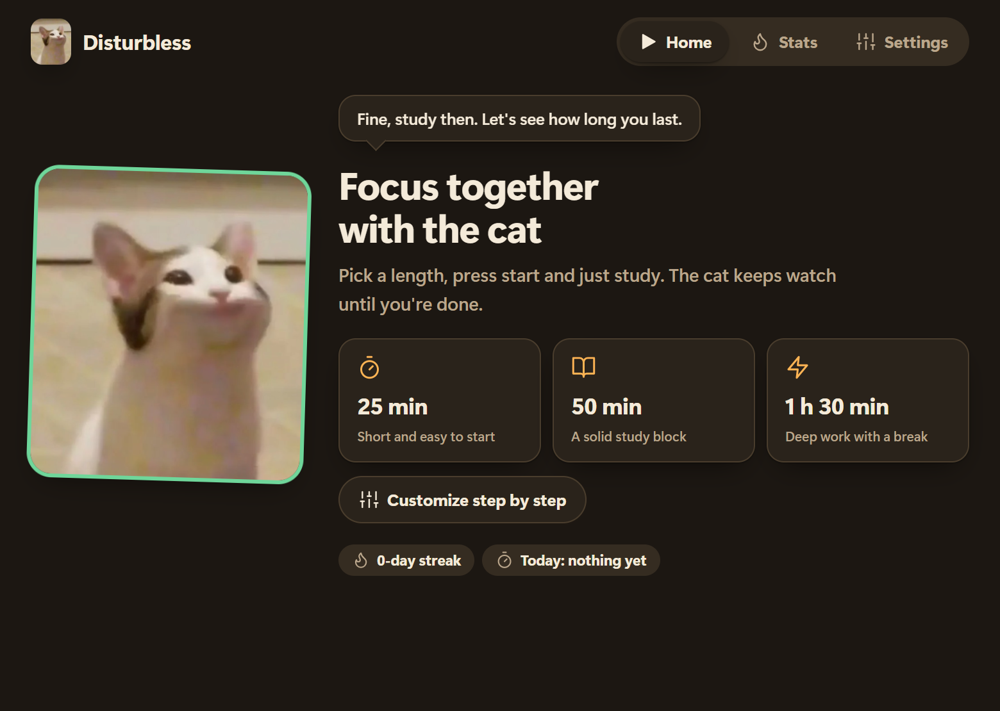
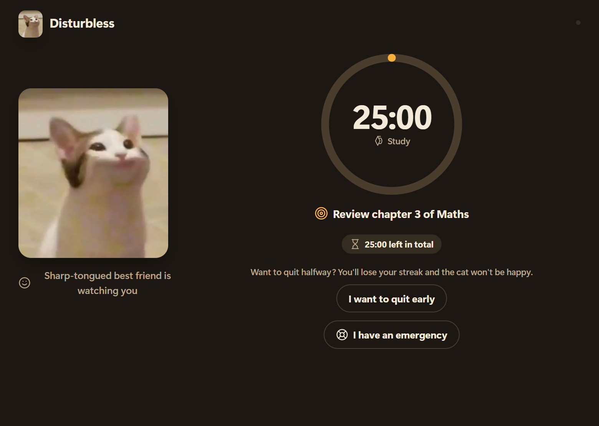
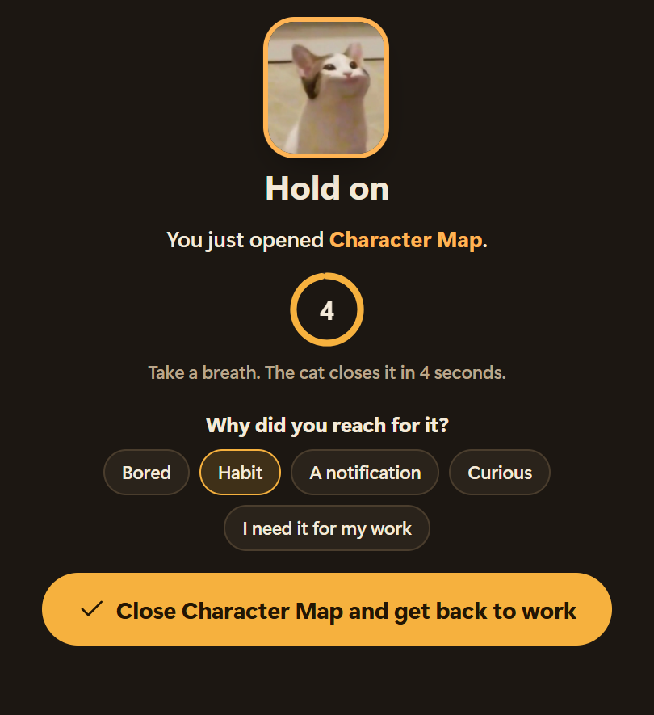

# Disturbless

[](https://github.com/Khanh1916/disturbless/actions/workflows/ci.yml)
[](https://github.com/Khanh1916/disturbless/releases)
[](LICENSE)


English | [Tiếng Việt](README.vi.md)

Disturbless is a focus lock for Windows. You pick a duration, press start, and you cannot quit until the time is up. It closes the apps you blocked, blocks websites, and closes the browser tab you are watching when it is on the banned list. A cat watches over you, scolds you, and slaps you when you try to cheat.

It is built for people who are not technical. The common case takes one click, and every screen is written in plain words, in Vietnamese or English.



## Features

- One-click sessions of 25, 50 or 90 minutes, or a short wizard for goal, length, breaks, what to block and how strict the cat should be.
- Blocks apps by name (block-list) or allows only the apps you pick (allow-list). Windows programs and system processes are never touched.
- Blocks websites through the hosts file, and closes the active browser tab when its title matches a banned site (Chrome, Edge, Firefox, Brave, Opera, Vivaldi).
- A pause gate: when a blocked app or tab shows up, a small card makes you stop for five seconds and say why you reached for it. The reasons feed the stats page.
- Hard to leave on purpose: wait through a cooldown, then retype one to three sentences with pasting disabled. The cooldown and the length depend on the strictness level.
- An emergency button for real life: pause for 10 minutes once per session, or end the session with a reason. Both are logged and neither breaks your streak.
- Stats with streaks, daily minutes, completion rate and the apps that pull you away most.
- Pomodoro-style rounds with breaks, a full-screen lock mode for studying away from the screen, and a note on what you are working on.
- Vietnamese and English interface, three text sizes, light and dark theme that follow Windows.



## Install

Download `Disturbless.exe` from the [latest release](https://github.com/Khanh1916/disturbless/releases/latest) and run it. There is no installer. The app needs WebView2, which ships with Windows 10 and 11.

The file is not code-signed yet, so SmartScreen may warn you the first time. Compare the SHA-256 on the release page if you want to be sure the file is the one built from this repository.

Your data lives in `%APPDATA%\disturbless\disturbless.json`.

## How blocking works

Windows has no way to stop an app before it opens, so Disturbless detects it and then closes it.

| Target | What happens |
| --- | --- |
| App | The pause gate appears, then after 5 seconds the app gets a polite close (`WM_CLOSE`). On the stricter levels it is force-closed 4 seconds later. |
| Browser tab | The window title is parsed. A banned site name at the end of the title matches, so "Steam engine - Wikipedia" does not. After the gate, Ctrl+W is sent only if the same browser window with the same title is still in front. |
| Website | Lines for `0.0.0.0` and `::` go into the hosts file between `# >>> DISTURBLESS BEGIN` and `# <<< DISTURBLESS END`. Windows asks for permission once at the start and once at the end. |

If you decline the permission prompt, apps and tabs are still blocked.



## Build from source

You need Rust (MSVC toolchain) and the Visual Studio Build Tools with the "Desktop development with C++" workload.

```powershell
git clone https://github.com/Khanh1916/disturbless.git
cd disturbless
cargo test --workspace
cargo build --release -p disturbless
```

The executable lands in `target\release\disturbless.exe`. The web UI is embedded at build time, so rebuild after editing anything in `renderer/`.

Helper scripts for local work are in `scripts/dev/`: `env.ps1` (build environment without touching `PATH`), `run-sandbox.ps1` (run the app on throw-away data with a debug port), `cdp.js` (drive a window and take screenshots) and `check-i18n.js` (the Vietnamese and English keys must match).

Environment variables for testing only: `DL_DATA` (data folder), `DL_NOHOSTS=1` (skip the hosts file and the UAC prompt), `DL_DEV=1` with `DL_COOLDOWN` and `DL_PAUSE_MS` (shorter waits), `DL_LOG=<file>` (trace log).

## Project layout

| Path | Contents |
| --- | --- |
| `core/` | Pure logic with no UI and no Win32: session engine, stats, blocking rules, tab matching, hosts text, profiles, storage, cat lines. |
| `app/` | The Tauri shell: windows, tray, session controller, IPC, and all Win32 calls in `winapi.rs`. |
| `renderer/` | The HTML, CSS and JavaScript UI. Text is in `i18n.js`, icons in `icons.js`. |
| `core-esm/`, `rust/` | The original JavaScript of four core modules and the rust-anything crates that hold its recorded behaviour. |
| `docs/` | Architecture notes and the manual test recipes. |
| `scripts/dev/` | Developer helper scripts. |

The project began as an Electron app. I moved it to Rust with [rust-anything](https://github.com/erkamyaman/rust-anything): the tool recorded what the JavaScript returned on generated and hand-written inputs, and the Rust port had to match. The tab matcher agrees on 1426 of 1426 recorded cases, the hosts text on 249 of 249 and the blocking rules on 349 of 349. The stats module matches 128 of 160, and the other 32 are nonsensical inputs such as timestamps passed as strings. `docs/ARCHITECTURE.md` explains how to re-run the comparison.

## Documentation

`docs/ARCHITECTURE.md` covers the design and the data flow. `docs/TESTING.md` lists safe ways to test the real app, including the mistakes worth avoiding. `AGENTS.md` has the same information in the short form that coding agents read.

## Contributing

Issues and pull requests are welcome. Read [CONTRIBUTING.md](CONTRIBUTING.md) first, and [SECURITY.md](SECURITY.md) if you found a vulnerability. Everyone taking part follows the [Code of Conduct](CODE_OF_CONDUCT.md).

## License

Source code is released under the [MIT License](LICENSE). The cat photo in `renderer/cat/` and other third-party material are listed in [NOTICE.md](NOTICE.md) and are not covered by that license.
