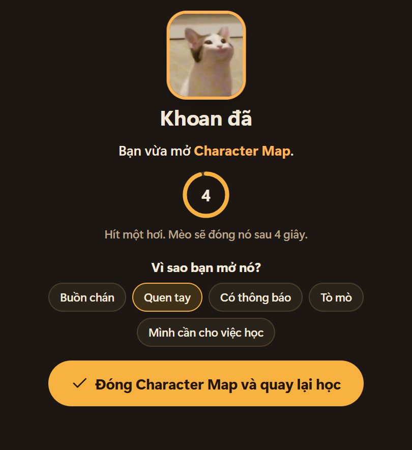

# Disturbless

[](https://github.com/Khanh1916/disturbless/actions/workflows/ci.yml)
[](https://github.com/Khanh1916/disturbless/releases)
[](LICENSE)


[English](README.md) | Tiếng Việt

Disturbless là app khóa tập trung trên Windows. Bạn chọn thời gian, bấm start, rồi ngồi làm cho tới khi hết giờ chứ không tắt ngang được. Cứ mở app bị chặn là app tự đóng, website bị chặn không vào được, tab trình duyệt mở trang cấm cũng bị tắt ngay. Còn có một con mèo ngồi canh, mắng và tát mỗi khi bạn tìm cách lách.

App làm cho người không rành kỹ thuật. Dùng bình thường chỉ cần 1 click. Mọi câu chữ trên màn hình đều viết dễ hiểu, có cả tiếng Việt lẫn tiếng Anh.


## Tính năng

- Bắt đầu nhanh với các mốc 25, 50 hoặc 90 phút chỉ bằng 1 click, hoặc qua setup wizard ngắn để chỉnh: mục tiêu, thời lượng, giờ nghỉ (break), block-list và mức khó tính của mèo.
- Chặn app theo blacklist (block-list) hoặc chỉ cho mở những app trong whitelist (allow-list). Tiến trình hệ thống và các app mặc định của Windows không bao giờ bị đụng tới.
- Chặn website bằng file hosts và đóng ngay tab trình duyệt khi tiêu đề khớp với trang cấm (hỗ trợ Chrome, Edge, Firefox, Brave, Opera, Vivaldi).
- Pause gate giữ chân 5 giây: app hoặc tab bị cấm vừa hiện lên thì một khung nhỏ bật ra, bắt bạn dừng lại 5 giây và chọn lý do mở để lưu vào trang stats.
- Chống tắt ngang bằng cooldown: muốn thoát sớm phải ngồi đợi hết thời gian chờ, rồi gõ lại từ 1 đến 3 câu văn mà không cho paste. Cooldown bao lâu và gõ bao nhiêu câu tùy vào mức nghiêm khắc đã chọn.
- Nút emergency khi có việc đột xuất: tạm dừng 10 phút (mỗi phiên được dùng một lần) hoặc kết thúc phiên sớm kèm lý do. Hệ thống vẫn ghi nhận và không làm đứt streak.
- Trang stats theo dõi streak liên tục, số phút tập trung mỗi ngày, tỉ lệ hoàn thành và những app làm bạn xao nhãng nhiều nhất.
- Chia chặng Pomodoro có break nghỉ giữa hiệp, có chế độ lock toàn màn hình khi cần học bài ngoài đời thực, kèm dòng ghi chú việc đang làm ngay trên đồng hồ.
- Giao diện có tiếng Việt và tiếng Anh, ba cỡ chữ, tự đổi light/dark theme theo cài đặt Windows.


## Cài đặt

Tải `Disturbless.exe` ở [trang release mới nhất](https://github.com/Khanh1916/disturbless/releases/latest) về rồi mở lên dùng luôn, không cần cài đặt. App chạy trên WebView2, thành phần có sẵn trong Windows 10 và 11.

File chưa code-sign nên lần đầu mở có thể SmartScreen sẽ cảnh báo. Bạn có thể check mã hash SHA-256 trên trang release để đối chiếu đúng file build từ repo này.

Dữ liệu lưu tại `%APPDATA%\disturbless\disturbless.json`.

## Cơ chế chặn

Windows không chặn được app trước lúc nó mở, nên Disturbless phát hiện app vừa bật là đóng lại ngay.

| Mục tiêu | Cách xử lý |
| --- | --- |
| App | Pause gate hiện lên 5 giây, sau đó gửi tín hiệu đóng thông thường (`WM_CLOSE`). Ở các mức gắt hơn, 4 giây sau app sẽ bị force close. |
| Tab trình duyệt | Parse tiêu đề cửa sổ để so khớp. Tên site bị cấm phải nằm ở cuối title mới tính là match, nên đọc bài kiểu `Steam engine - Wikipedia` sẽ không bị đóng nhầm. Qua khỏi pause gate, phím tắt Ctrl+W chỉ gửi đi nếu đúng cửa sổ trình duyệt đó và đúng title đó vẫn đang active ở trên cùng. |
| Website | Ghi các dòng trỏ domain về `0.0.0.0` và `::` vào file hosts, kẹp giữa hai marker `# >>> DISTURBLESS BEGIN` và `# <<< DISTURBLESS END`. Windows sẽ hiện prompt UAC xin quyền admin một lần lúc bắt đầu và một lần lúc kết thúc phiên. |

Nếu từ chối prompt UAC sửa file hosts, app và tab trình duyệt vẫn bị chặn bình thường.



## Tự build

Bạn cần Rust (toolchain MSVC) và Visual Studio Build Tools với workload "Desktop development with C++".

```powershell
git clone https://github.com/Khanh1916/disturbless.git
cd disturbless
cargo test --workspace
cargo build --release -p disturbless
```

File thực thi sau khi build nằm tại `target\release\disturbless.exe`. Toàn bộ web UI được bundle thẳng vào file exe lúc build, nên sửa gì trong `renderer/` thì ta phải build lại.

Các script hỗ trợ kiểm thử nằm trong `scripts/dev/`:
- `env.ps1`: nạp môi trường build cục bộ, không đụng vào `PATH` hay Registry của hệ điều hành.
- `run-sandbox.ps1`: chạy thử app với thư mục dữ liệu tạm (sandbox) và mở debug port 9333.
- `cdp.js`: điều khiển cửa sổ qua Chrome DevTools Protocol và chụp screenshot.
- `check-i18n.js`: kiểm tra đồng bộ giữa các key tiếng Việt và tiếng Anh trong từ điển ngôn ngữ.

Một số biến môi trường phục vụ quá trình test: `DL_DATA` (chỉ định thư mục data), `DL_NOHOSTS=1` (bỏ qua sửa file hosts và không hiện prompt UAC), `DL_DEV=1` đi kèm `DL_COOLDOWN` và `DL_PAUSE_MS` (rút ngắn cooldown để test nhanh), `DL_LOG=<file>` (xuất log ra file).

## Cấu trúc thư mục

| Đường dẫn | Nội dung |
| --- | --- |
| `core/` | Logic thuần, tách biệt khỏi UI và Win32: session engine, stats, luật chặn, match tab, xử lý file hosts, profile, lưu trữ JSON và câu thoại của mèo. |
| `app/` | Tauri shell: quản lý window, system tray, session controller, IPC và toàn bộ code Win32 nằm trong `winapi.rs`. |
| `renderer/` | Web UI bằng HTML, CSS và JavaScript. Text đặt trong `i18n.js`, icon đặt trong `icons.js`. |
| `core-esm/`, `rust/` | Code JavaScript gốc của 4 module lõi và các crate rust-anything lưu baseline hành vi cũ để đối chiếu. |
| `docs/` | Ghi chú architecture và các kịch bản test tay. |
| `scripts/dev/` | Script hỗ trợ dev. |

Dự án ban đầu viết bằng Electron, sau đó tôi port sang Rust bằng [rust-anything](https://github.com/erkamyaman/rust-anything). Công cụ này ghi lại output của bản JavaScript trên các bộ test case mẫu (cả tự sinh lẫn viết tay), rồi kiểm tra xem bản Rust port sang có cho ra kết quả khớp hoàn toàn hay không. Kết quả đối chiếu: bộ match tab khớp 1426/1426 test case, phần sinh hosts khớp 249/249, luật chặn khớp 349/349. Module stats khớp 128/160 case, 32 case lệch còn lại là do input vô lý như truyền timestamp bằng chuỗi chữ. Đọc `docs/ARCHITECTURE.md` nếu bạn muốn chạy lại bài test này.

## Tài liệu

- `docs/ARCHITECTURE.md`: giải thích chi tiết kiến trúc thiết kế và data flow.
- `docs/TESTING.md`: hướng dẫn các test recipe an toàn trên app thật, kèm những chỗ dễ nhầm cần tránh để không tự khóa máy mình.
- `AGENTS.md`: tóm tắt toàn bộ quy tắc dự án và cấu trúc hệ thống dành cho các coding agent.

## Đóng góp

Bạn cứ thoải mái mở issue hoặc gửi pull request. Nhớ đọc [CONTRIBUTING.md](CONTRIBUTING.md) trước khi làm, và xem [SECURITY.md](SECURITY.md) nếu phát hiện lỗ hổng bảo mật. Ai tham gia cũng cần tuân thủ [Code of Conduct](CODE_OF_CONDUCT.md).

## Giấy phép

Mã nguồn phát hành theo [license MIT](LICENSE). Ảnh mèo trong thư mục `renderer/cat/` và tài nguyên third-party được liệt kê trong [NOTICE.md](NOTICE.md), không nằm trong license này.
