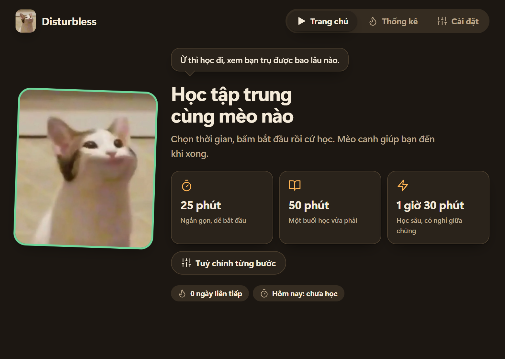
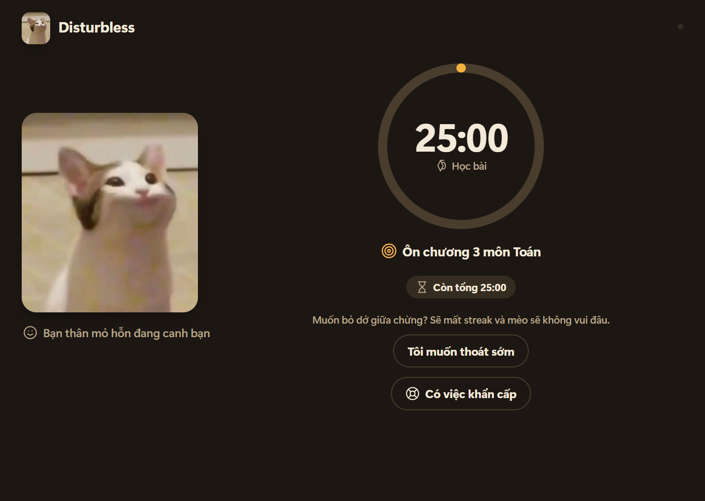

# Disturbless

[](https://github.com/Khanh1916/disturbless/actions/workflows/ci.yml)
[](https://github.com/Khanh1916/disturbless/releases)
[](LICENSE)


[English](README.md) | Tiếng Việt

Disturbless là app khóa tập trung cho Windows. Bạn chọn thời gian, bấm bắt đầu, và không thoát được cho tới khi hết giờ. App đóng các ứng dụng bạn đã chặn, chặn website, và đóng luôn tab trình duyệt đang xem nếu tab đó nằm trong danh sách cấm. Có một chú mèo ngồi canh, mắng và tát khi bạn tìm cách lách.

App làm cho người không rành công nghệ. Trường hợp thường gặp chỉ cần một cú bấm, mọi màn hình viết bằng lời đơn giản, có tiếng Việt và tiếng Anh.



## Tính năng

- Bắt đầu nhanh với 25, 50 hoặc 90 phút, hoặc đi qua trình hướng dẫn ngắn: mục tiêu, thời gian, giờ nghỉ, thứ cần chặn, mức nghiêm khắc của mèo.
- Chặn app theo tên (danh sách đen) hoặc chỉ cho dùng các app bạn chọn (danh sách trắng). Chương trình của Windows và tiến trình hệ thống không bao giờ bị đụng tới.
- Chặn website qua file hosts, và đóng tab trình duyệt đang xem khi tiêu đề khớp trang bị cấm (Chrome, Edge, Firefox, Brave, Opera, Vivaldi).
- Cổng dừng 5 giây: khi một app hay tab bị chặn xuất hiện, một thẻ nhỏ bắt bạn dừng lại năm giây và chọn lý do mở nó. Lý do được ghi vào trang thống kê.
- Muốn thoát sớm phải chờ hết thời gian chờ, rồi gõ lại một đến ba câu, không dán được. Thời gian chờ và độ dài câu phụ thuộc mức nghiêm khắc.
- Nút khẩn cấp cho việc thật: tạm dừng 10 phút (một lần mỗi phiên) hoặc dừng hẳn kèm lý do. Cả hai đều được ghi lại và không làm mất chuỗi ngày.
- Thống kê chuỗi ngày, số phút mỗi ngày, tỉ lệ hoàn thành và những app hay kéo bạn đi nhất.
- Chia vòng kiểu Pomodoro có giờ nghỉ, chế độ khóa cả màn hình để học ngoài máy, và dòng ghi lần này bạn đang làm gì.
- Giao diện tiếng Việt và tiếng Anh, ba cỡ chữ, nền sáng hoặc tối theo Windows.



## Cài đặt

Tải `Disturbless.exe` ở [bản release mới nhất](https://github.com/Khanh1916/disturbless/releases/latest) rồi chạy. Không có trình cài đặt. App cần WebView2, thành phần này có sẵn trong Windows 10 và 11.

File chưa được ký số nên lần đầu SmartScreen có thể cảnh báo. Muốn chắc file đúng là bản build từ repo này, bạn so SHA-256 ghi trên trang release.

Dữ liệu của bạn nằm ở `%APPDATA%\disturbless\disturbless.json`.

## Cách chặn hoạt động

Windows không cho chặn một app trước khi nó mở, nên Disturbless phát hiện rồi mới đóng.

| Đối tượng | Việc xảy ra |
| --- | --- |
| App | Cổng dừng hiện lên, sau 5 giây app nhận lệnh đóng nhẹ nhàng (`WM_CLOSE`). Ở các mức gắt hơn, 4 giây sau nó bị tắt cứng. |
| Tab trình duyệt | Tiêu đề cửa sổ được tách ra để so. Tên trang bị cấm đứng ở cuối tiêu đề thì mới khớp, nên "Steam engine - Wikipedia" không bị nhầm. Sau cổng, Ctrl+W chỉ được gửi khi đúng cửa sổ trình duyệt đó, đúng tiêu đề đó, vẫn đang ở trên cùng. |
| Website | Các dòng `0.0.0.0` và `::` được ghi vào file hosts, nằm giữa `# >>> DISTURBLESS BEGIN` và `# <<< DISTURBLESS END`. Windows hỏi quyền một lần lúc bắt đầu và một lần lúc xong. |

Nếu bạn từ chối hộp hỏi quyền, app và tab vẫn bị chặn như thường.


## Tự build

Bạn cần Rust (toolchain MSVC) và Visual Studio Build Tools với workload "Desktop development with C++".

```powershell
git clone https://github.com/Khanh1916/disturbless.git
cd disturbless
cargo test --workspace
cargo build --release -p disturbless
```

File chạy nằm ở `target\release\disturbless.exe`. Giao diện web được nhúng vào exe lúc build, nên sửa gì trong `renderer/` thì phải build lại.

Script hỗ trợ nằm trong `scripts/dev/`: `env.ps1` (môi trường build, không đụng `PATH`), `run-sandbox.ps1` (chạy app trên dữ liệu tạm, có cổng gỡ lỗi), `cdp.js` (điều khiển cửa sổ và chụp màn hình) và `check-i18n.js` (khóa tiếng Việt và tiếng Anh phải khớp nhau).

Biến môi trường chỉ dùng khi thử: `DL_DATA` (thư mục dữ liệu), `DL_NOHOSTS=1` (không sửa hosts, không hiện UAC), `DL_DEV=1` cùng `DL_COOLDOWN` và `DL_PAUSE_MS` (rút ngắn thời gian chờ), `DL_LOG=<file>` (ghi log).

## Cấu trúc thư mục

| Đường dẫn | Nội dung |
| --- | --- |
| `core/` | Logic thuần, không có giao diện và không gọi Win32: engine của phiên, thống kê, luật chặn, so khớp tab, văn bản hosts, hồ sơ, lưu trữ, lời mèo. |
| `app/` | Vỏ Tauri: cửa sổ, khay hệ thống, bộ điều khiển phiên, IPC, và mọi lời gọi Win32 trong `winapi.rs`. |
| `renderer/` | Giao diện HTML, CSS, JavaScript. Chữ nằm trong `i18n.js`, biểu tượng trong `icons.js`. |
| `core-esm/`, `rust/` | Mã JavaScript gốc của bốn module lõi và các crate rust-anything giữ hành vi đã ghi lại của chúng. |
| `docs/` | Ghi chú kiến trúc và công thức thử bằng tay. |
| `scripts/dev/` | Script hỗ trợ cho người phát triển. |

Dự án bắt đầu là app Electron. Tôi chuyển nó sang Rust bằng [rust-anything](https://github.com/erkamyaman/rust-anything): công cụ ghi lại kết quả của bản JavaScript trên các đầu vào sinh tự động và viết tay, và bản Rust phải khớp với kết quả đó. Phần so khớp tab khớp 1426 trên 1426 ca, văn bản hosts khớp 249 trên 249, luật chặn khớp 349 trên 349. Phần thống kê khớp 128 trên 160, 32 ca còn lại là đầu vào vô lý như mốc thời gian bị truyền vào dưới dạng chuỗi. `docs/ARCHITECTURE.md` hướng dẫn chạy lại phép so này.

## Tài liệu

`docs/ARCHITECTURE.md` nói về thiết kế và luồng dữ liệu. `docs/TESTING.md` liệt kê cách thử an toàn trên app thật, kèm những lỗi nên tránh. `AGENTS.md` chứa cùng thông tin ở dạng ngắn mà các coding agent đọc.

## Đóng góp

Issue và pull request đều được chào đón. Đọc [CONTRIBUTING.md](CONTRIBUTING.md) trước, và [SECURITY.md](SECURITY.md) nếu bạn tìm thấy lỗ hổng. Mọi người tham gia theo [Quy tắc ứng xử](CODE_OF_CONDUCT.md).

## Giấy phép

Mã nguồn phát hành theo [giấy phép MIT](LICENSE). Ảnh mèo trong `renderer/cat/` và các tài liệu của bên thứ ba được liệt kê trong [NOTICE.md](NOTICE.md), không nằm trong giấy phép đó.
